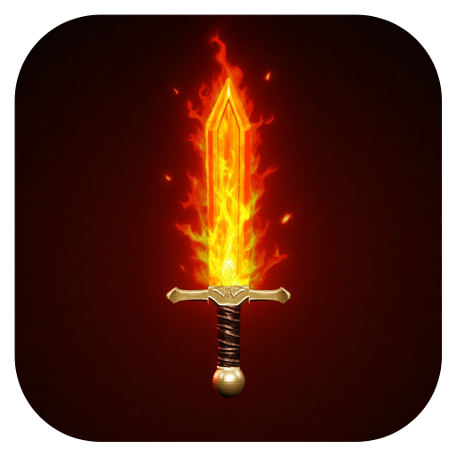
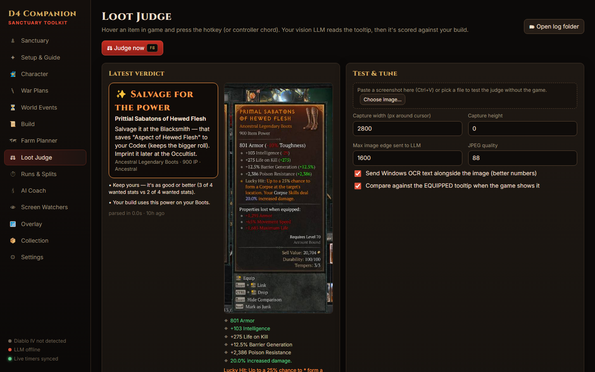
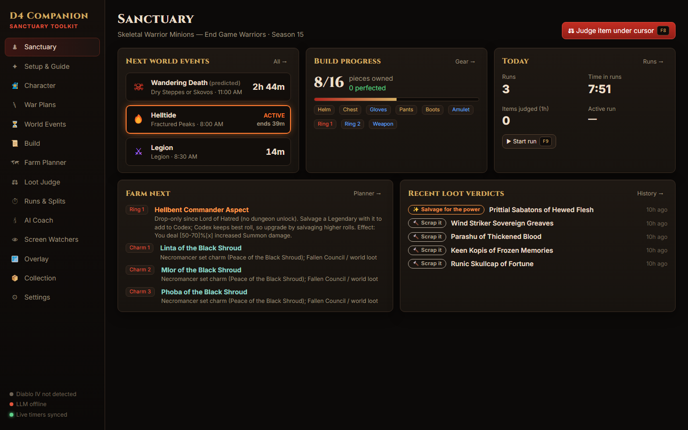
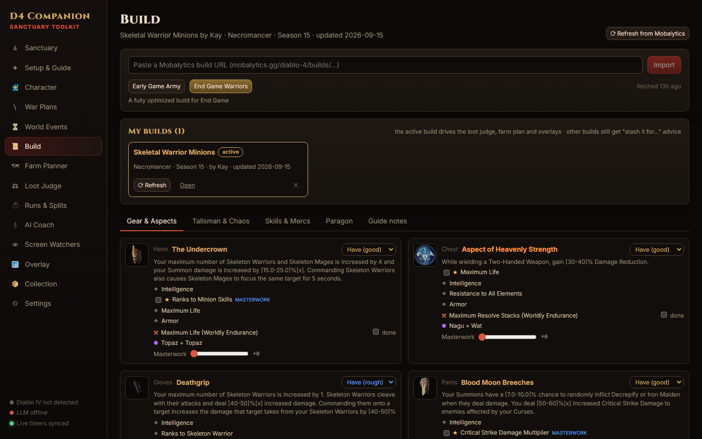
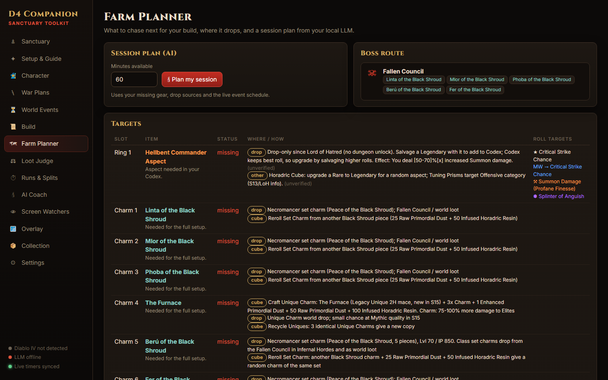
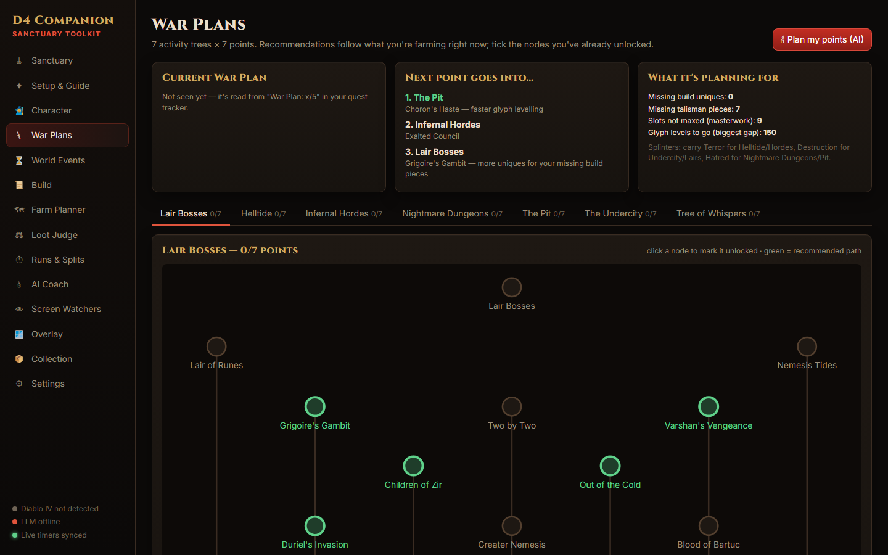
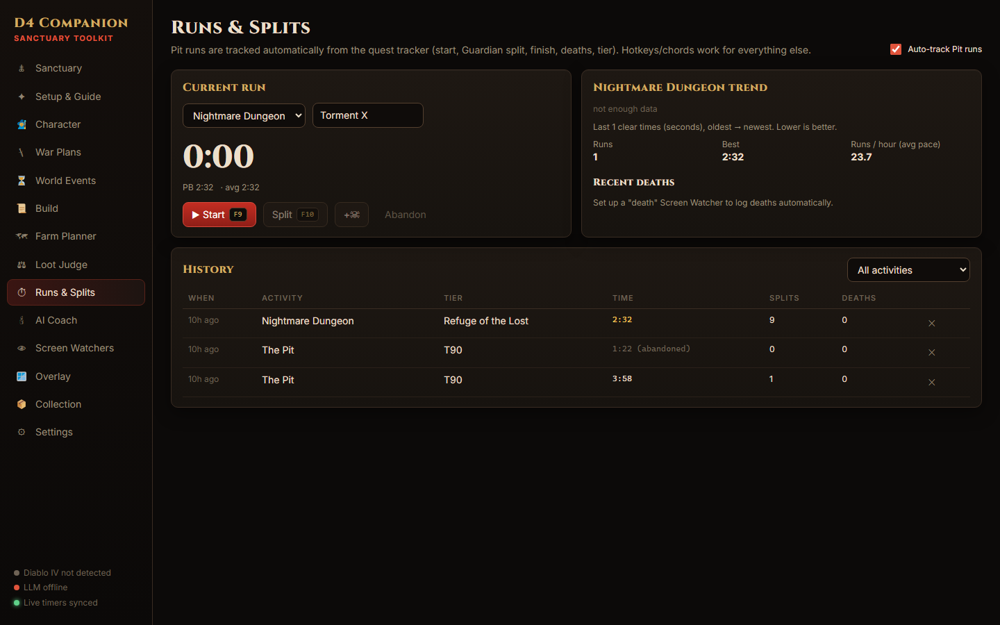

# Sanctuary Toolkit

[](https://github.com/mscrnt/diablo-companion/releases/latest)
[](https://github.com/mscrnt/diablo-companion/actions/workflows/ci.yml)
[](https://github.com/mscrnt/diablo-companion/releases)
[](#for-players-install--use)
[](https://github.com/mscrnt/diablo-companion/releases/latest)
[](LICENSE.md)
[](https://tauri.app)

Desktop companion for Diablo IV (Tauri 2 + React). Screen-reading only: capture,
Windows OCR and a local vision LLM — no memory reading, no injection, no input sending.

**[Download the latest installer](https://github.com/mscrnt/diablo-companion/releases/latest)**



| | |
|---|---|
|  **Dashboard**: next world events, build progress, recent verdicts |  **Build**: your Mobalytics build, slot by slot, with progress |
|  **Farm Planner**: where each missing piece drops |  **War Plans**: which nodes to unlock next |
|  **Runs & Splits**: Pit and Nightmare Dungeon runs tracked automatically | |

## For players (install & use)
1. Run the installer from the [latest release](https://github.com/mscrnt/diablo-companion/releases/latest). No admin rights needed, and installing over an older version keeps your settings.
   - `Sanctuary Toolkit_x.y.z_x64-setup.exe` (recommended, ~6 MB): uses the WebView2 runtime that Windows 10 and 11 already have, and fetches it only if it's missing.
   - `Sanctuary Toolkit_x.y.z_x64-offline-setup.exe` (~210 MB): includes the WebView2 runtime, for PCs without internet access.
2. On first start, paste your **Mobalytics build link** (featured guide or profile build). Add more builds any time on the **Build** page — the active one drives the loot judge; the others still get "stash it — great for your other build" advice. Builds show an **update** badge when the author changes the guide.
3. Optional: point **Settings → Local LLM** at any OpenAI-compatible server (vLLM, LM Studio, Ollama…) for the AI Coach/session plans. Everything else works without it.
4. In game: Display Mode **Windowed Fullscreen**; hover your equipped gear once so it knows what you wear.

Screen-reading only (capture + Windows OCR): no memory reading, no injection, no input.

## Run (development)
```
npm install
npx tauri dev
```
Rust is pinned to 1.92 via `rust-toolchain.toml` (rustup installs it automatically).
Game: Display Mode **Windowed Fullscreen** so the overlay can draw.

## Configure (Settings page)
- **LLM** (optional): any OpenAI-compatible endpoint, e.g. vLLM serving Qwen3.5-35B-A3B (vision) — used for the AI Coach, session plans and as the loot-parse fallback
- **FlareSolverr** (optional): only needed if the Mobalytics GraphQL API is unavailable
- Hotkeys / controller chords, OBS websocket, Discord webhook

## Tests
```
npm test            # Vitest: loot judge on logged tooltips, build import, timers, activity helpers
npm run typecheck
```
CI (`.github/workflows/ci.yml`) runs the typecheck, tests, web build and `cargo check` on every push and PR.

## Debugging
Everything is local, under `%LOCALAPPDATA%\com.kenneth.d4companion\logs\debug\` (the **Debug** page shows it live, and opens the folder):
- `state.json`: what the app believes right now, rewritten every 2 s while **test mode** is on: game window, DPI and black bars, current activity (Pit, NMD, Helltide, boss, Hordes, Tree, War Plan), the loot judge's last scan (region, tooltip found or why not, boxes, verdict, quiet mode, snooze), map pins, skill bar, LLM and live timers, recent errors, and the overlay's own report of what it draws and where (CSS and screen px; the overlay is hidden from screen capture).
- `events-YYYY-MM-DD.jsonl`: one JSON line per decision (`ts`, `src`, `type`, `data`) from every subsystem, including skipped and negative decisions, plus uncaught errors and console warnings from both windows. Test mode only; it gets a tenth of test mode's size budget.
- `marks/<time>/`: press **Ctrl+Alt+D** (controller: **View + RB**) in game to mark a moment, even with test mode off: `screenshot.jpg` (game window, full resolution), `state.json`, `events.jsonl` (the last 90 s), `overlay.json` and an optional `note.txt` added on the Debug page. The newest 30 are kept.

Secrets (LLM API key, Discord webhook, OBS password) are never written. **Send debug report** (Debug page or Settings → About) zips these with recent judge logs and test-mode records and, once you confirm, uploads the zip to the report service: a Cloudflare Worker (`worker/`) that stores it privately for 30 days and returns a report ID. The app holds no storage credentials. If the upload fails, or you choose **Save it instead**, the zip goes to Downloads with a pre-filled GitHub issue link.

## Release
Add notes under **Unreleased** in [CHANGELOG.md](CHANGELOG.md) as you go. The version bump turns them into the new version's section, and that section becomes the GitHub release notes. A release won't build without notes.

Versions follow [semantic versioning](https://semver.org): `patch` for fixes only, `minor` when the release adds features (an **Added** section in the changelog means minor), `major` for breaking changes.

- **From GitHub:** Actions → *Release* → *Run workflow*, enter `patch`, `minor`, `major` or an exact `x.y.z`. It bumps the version files, commits, tags `vX.Y.Z` on main, builds the installer and publishes a GitHub release with it attached.
- **From a terminal:** `npm run version -- 0.2.0`, commit, `git tag v0.2.0`, `git push --follow-tags`. Pushing the tag triggers the same build.
- **Local installer only:** `npx tauri build` → `src-tauri/target/release/bundle/nsis/Sanctuary Toolkit_<ver>_x64-setup.exe`.

## Data refresh
```
node scripts/fetch-mobalytics-static.mjs && node scripts/slim-static.mjs   # game data tables
node tools/datamine/extract.mjs --update-defs                             # strings from local game files (after a patch)
node scripts/gen-ocr-vocab.mjs                                            # OCR vocabulary (needs both of the above)
```
`research/` holds the S15 farming knowledge and timer source notes used by the app.

## Layout
- `src-tauri/src` — capture (xcap), Windows OCR, game-window watcher, XInput reader, tray
- `src/lib` — engine (timers, hotkeys, watchers), loot judge, guide, farm planner, importers
- `src/overlay` — transparent click-through overlay (docks into the black pillarbox bars)
- `src/pages` — dashboard UI
- `tests` — Vitest suite; `tests/fixtures/tooltips` are real OCR'd tooltips from the judge log
- `scripts/dev` — `node scripts/dev/run.mjs <name>` runs exploratory scripts against your local judge log and app state

See `ROADMAP.md` for what's next.

## License
The code is released under the [PolyForm Noncommercial License 1.0.0](LICENSE.md): free to use, modify and share for personal, hobby, research and other noncommercial purposes. Commercial use is not permitted.

Game data bundled in `src/generated` and `src/seed` (from Mobalytics and the Diablo IV game files) belongs to its respective owners and isn't covered by this license.

Diablo® and Diablo IV are trademarks of Blizzard Entertainment, Inc. This project is a fan-made tool and is not affiliated with or endorsed by Blizzard Entertainment or Mobalytics.
